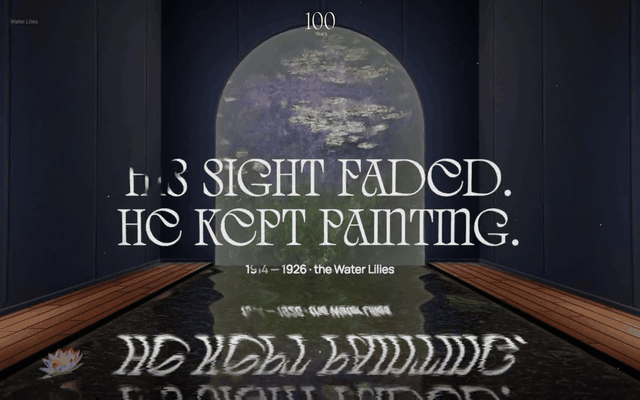
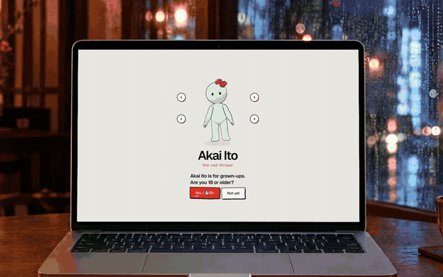
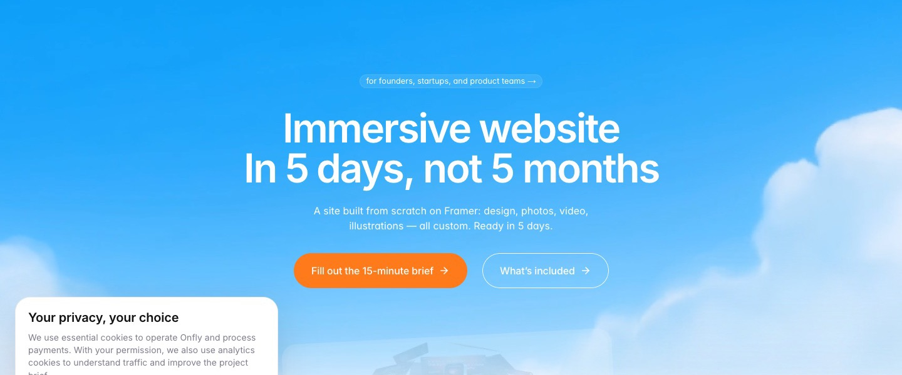
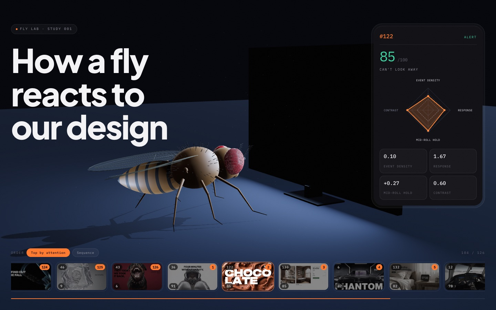
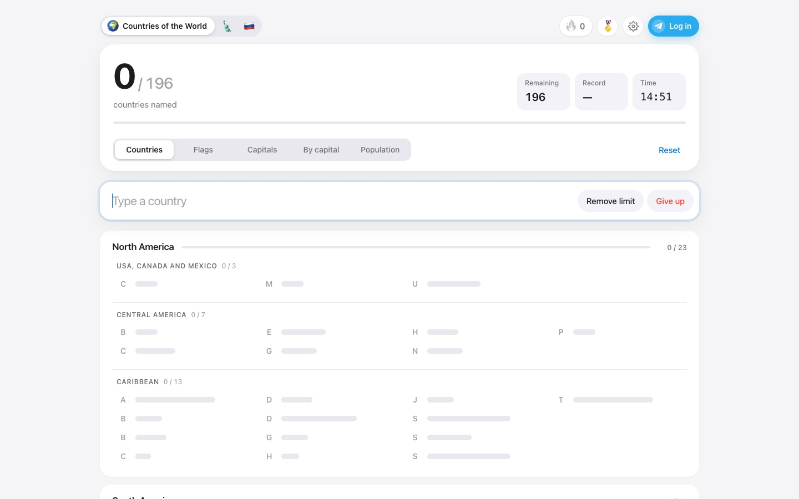

# Egor Galiy

**Design engineer — WebGL, 3D and interactive web.**
I design, code and ship the whole thing myself.

Eight years, 500+ projects, 50+ awards — for Yandex, MTS Bank and Art. Lebedev Studio.
Now at [Ubernatural](https://ubernatural.io/), where I also run the product side of [onfly](https://onfly.design/): immersive websites in days, not months.

[egor.digital](https://egor.digital) · [LinkedIn](https://www.linkedin.com/in/galiy) · [Telegram](https://t.me/egaliy) · [egor@egor.digital](mailto:egor@egor.digital)

---

### Selected work

<table>
  <tr>
    <td width="50%" valign="top">
      
      <b><a href="https://100yearsmonet.com">Monet 100</a></b> 
      An immersive WebGL tribute to Claude Monet: a walk through his garden and paintings, 100 years on.
    </td>
    <td width="50%" valign="top">
      
      <b><a href="https://akai-ito-kappa.vercel.app">Akai Ito</a></b> 
      Concept for an AI dating product: your digital twin goes on millions of first dates, you go on one.
    </td>
  </tr>
  <tr>
    <td width="50%" valign="top">
      
      <b><a href="https://onfly.design">onfly</a></b> 
      Immersive websites in days, not months. I built it end to end: brand, sites, automated briefs, CRM routing and an AI sales agent.
    </td>
    <td width="50%" valign="top">
      
      <b><a href="https://fly-lab-lovat.vercel.app">Fly Lab</a></b> 
      126 design concepts judged by a connectome-based model of a fruit fly's visual system. Three.js.
    </td>
  </tr>
</table>

### Games I build after hours

Real players, one shared Telegram login, achievements and leaderboards.

<table>
  <tr>
    <td width="33%" valign="top">
      
      <b><a href="https://countries-game-khaki.vercel.app">Countries of the World</a></b> 
      196 countries, flags and capitals against the clock.
    </td>
    <td width="33%" valign="top">
      
      <b><a href="https://sudoku-duel-rosy.vercel.app">Sudoku Battle</a></b> 
      One grid, up to 10 friends, first to solve wins. Tomatoes allowed.
    </td>
    <td width="33%" valign="top">
      
      <b><a href="https://us-states-game-delta.vercel.app">US States</a></b> 
      All 50 states on an interactive map.
    </td>
  </tr>
</table>

### Experience

| | |
|---|---|
| **Ubernatural + onfly** · 2025–now | Design engineer & product owner of onfly. ~50 one-day launches, three Awwwards Honorable Mentions. |
| **Art. Lebedev Studio** · 2025 | Web designer. |
| **Yandex Eats** · 2023 | Lead web designer for the whole food division, 14 languages. |
| **MTS Bank** · 2022 | Senior web designer & developer, special projects. 54 landing pages in a year, 20+ awards, six browser games. |

**Awards:** Awwwards Honorable Mention ×3 · Made on Tilda ×18 · Best CSS ×16 · TopDesignKing ×12

**Tools:** JavaScript · Three.js / WebGL · Blender · Vite · Node · Vercel · Cloudflare · Figma · Claude Code
